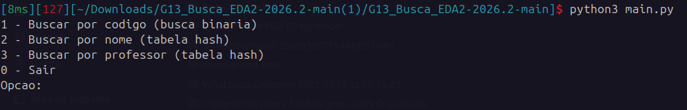
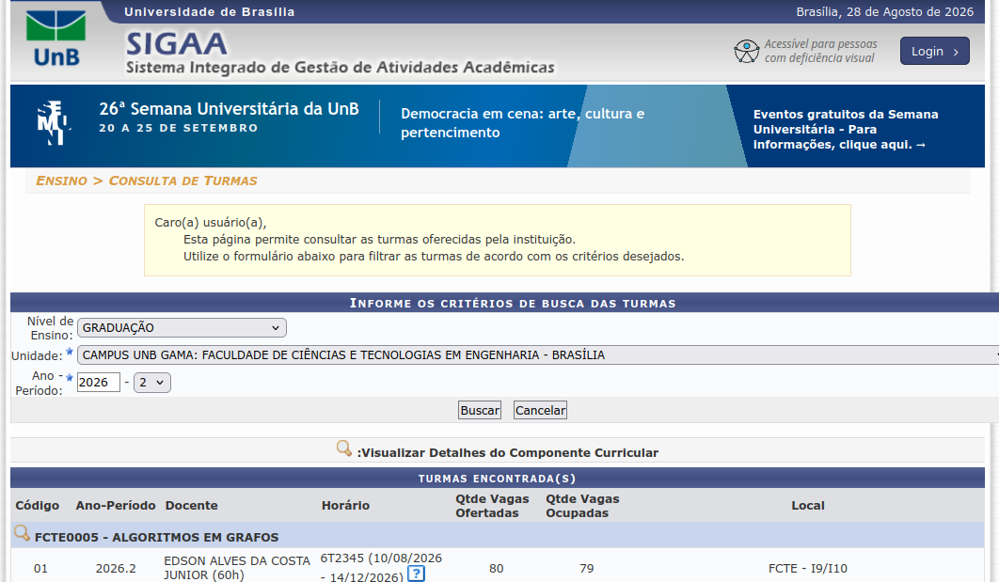

# G13_Busca_EDA2-2026.2

## Busca Matérias UnB Gama

Projeto desenvolvido para a disciplina de **Estruturas de Dados e Algoritmos 2 (EDA2)**.

O programa permite buscar disciplinas ofertadas na **FCTE - UnB Gama** por código, nome ou professor, utilizando Insertion Sort, busca binária e tabelas hash.

## Alunos

| Matrícula | Nome |
| --- | --- |
| 22/2037675 | Gabriel Santos Pinto |
| 23/1030691 | Guilherme Ferreira Brandão |

## Sobre o projeto

A base utilizada possui **134 disciplinas do período 2026.2**. Os dados estão em `data/disciplinas.json` e foram obtidos a partir da consulta pública de turmas do SIGAA da UnB.

Os registros do JSON estão fora de ordem por código. A cada execução, o programa utiliza o **Insertion Sort** para preparar uma cópia ordenada em memória, sem alterar o arquivo JSON.

As buscas disponíveis são:

- **Código:** busca binária na lista ordenada;
- **Nome:** tabela hash com índice das palavras dos nomes;
- **Professor:** tabela hash com índice dos nomes completos dos professores.

## Fluxo de execução

1. Carregar as disciplinas do JSON desordenado.
2. Ordenar uma cópia das disciplinas por código com Insertion Sort.
3. Construir os índices hash de nome e professor usando a lista ordenada.
4. Exibir o menu e atender às consultas.

A busca binária reutiliza a lista preparada, sem ordenar novamente a cada consulta. As tabelas hash não exigem ordenação, mas são construídas após essa etapa para seguir o fluxo do programa.

## Insertion Sort

O algoritmo está em `src/insertion_sort.py`. Ele percorre a lista a partir do segundo elemento e, em cada passagem:

1. Guarda a disciplina atual.
2. Desloca para a direita as disciplinas anteriores com código maior.
3. Insere a disciplina atual na posição encontrada.

A comparação utiliza `>` para preservar a ordem original entre disciplinas com códigos iguais. Portanto, o algoritmo é estável.

O melhor caso tem complexidade **O(n)**, quando a entrada já está ordenada. Os casos médio e pior têm complexidade **O(n²)**. A função utiliza **O(n)** de espaço adicional por criar uma cópia da lista; os deslocamentos em si utilizam espaço auxiliar constante. Na demonstração, também são criadas cópias dos estados da lista para exibir os passos.

## Como executar

É necessário ter Python 3 instalado. O projeto utiliza apenas a biblioteca padrão, sem dependências externas.

Na raiz do projeto, onde está `main.py`, execute:

```bash
python main.py
```

Ao iniciar, o programa mostra os primeiros cinco códigos antes e depois da ordenação e informa a quantidade total de disciplinas ordenadas.

O menu apresenta:

```text
1 - Buscar por codigo (busca binaria)
2 - Buscar por nome (tabela hash)
3 - Buscar por professor (tabela hash)
4 - Demonstrar Insertion Sort
0 - Sair
```

## Demonstração no terminal

Escolha a opção **4** para acompanhar o Insertion Sort sobre as **134 disciplinas na ordem real do JSON**. A demonstração mostra:

- A lista antes da ordenação;
- O código selecionado em cada passagem;
- Cada deslocamento para a direita;
- A posição de inserção e a lista após cada passagem;
- A lista final ordenada.

As posições exibidas começam em zero. Como a demonstração utiliza toda a base, a saída no terminal é extensa. Ao terminar, o programa retorna ao menu. A demonstração preserva os dados originais e os índices já construídos.

Também é possível executar apenas a demonstração, a partir da raiz do projeto:

```bash
python -m src.demonstracao_insertion
```

## Exemplo



A imagem acima registra as buscas da versão anterior à inclusão da demonstração do Insertion Sort.

## Fonte dos dados

Os dados foram retirados da página pública do SIGAA da Universidade de Brasília.



## Vídeo de apresentação

[](https://www.youtube.com/watch?v=0g1k7X8J6xM)
